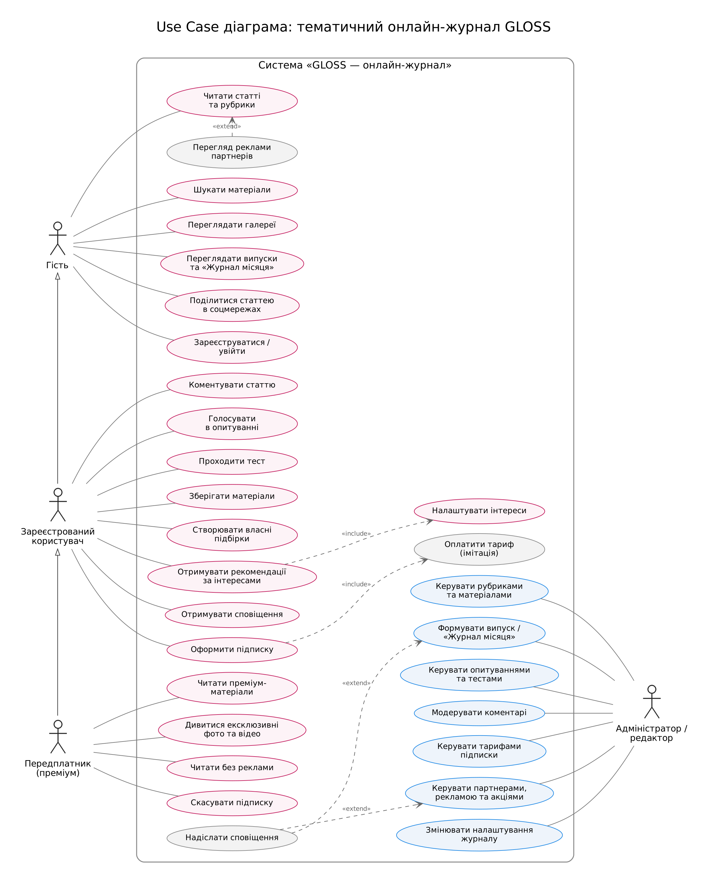
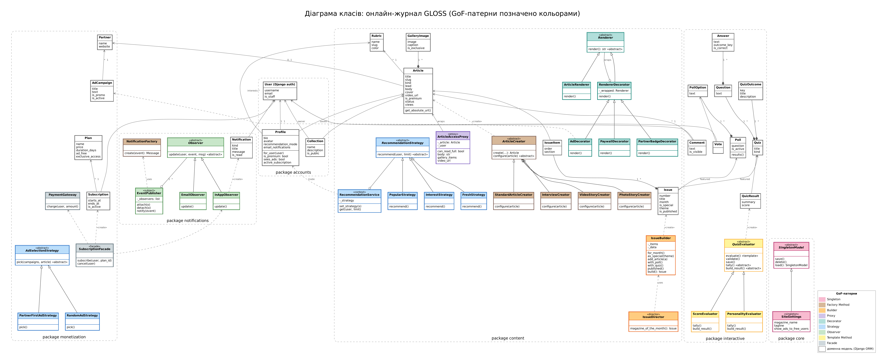

# Діаграми системи

Файли лежать у `docs/diagrams/`: PNG — для звіту, SVG — для перегляду з масштабуванням, `.dot` — вихідні тексти (Graphviz).

Перегенерувати:

```
cd docs/diagrams
python build_class_diagram.py
dot -Tpng -Gdpi=150 class_diagram.dot -o class_diagram.png
dot -Tpng -Gdpi=150 use_case.dot -o use_case.png
```

## 1. Use Case діаграма



**Актори** утворюють ієрархію узагальнення:

- **Гість** читає статті й рубрики, шукає матеріали, переглядає галереї та випуски, ділиться статтями в соцмережах, реєструється.
- **Зареєстрований користувач** успадковує все, що може гість, і додатково коментує, голосує в опитуваннях, проходить тести, зберігає матеріали, створює підбірки, отримує рекомендації та сповіщення, оформлює підписку.
- **Передплатник** — користувач з активним преміум-тарифом: читає преміум-матеріали, бачить ексклюзивні фото й відео, читає без реклами.
- **Адміністратор** керує контентом, випусками, опитуваннями й тестами, модерує коментарі, налаштовує тарифи, партнерів і рекламу.

**Зв'язки між прецедентами:**

- «Оформити підписку» **включає** «Оплатити тариф».
- «Отримувати рекомендації» **включає** «Налаштувати інтереси».
- «Перегляд реклами» **розширює** «Читати статті» (лише для безкоштовних читачів).
- «Надіслати сповіщення» **розширює** «Формувати випуск» і «Керувати акціями».

## 2. Діаграма класів



Класи згруповано за Django-застосунками (пакетами). Білі класи — доменна модель (таблиці БД), кольорові — реалізація GoF-патернів.

| Колір | Патерн | Класи | Роль у системі |
|---|---|---|---|
| Рожевий | Singleton | `SingletonModel`, `SiteSettings` | Налаштування журналу існують в одному екземплярі (`load()` завжди повертає запис з pk=1) |
| Коричневий | Factory Method | `ArticleCreator` + 4 підкласи; `NotificationFactory` | Кожен тип матеріалу (стаття, фотоісторія, відео, інтерв'ю) створюється своїм творцем зі своїми правилами |
| Оранжевий | Builder | `IssueBuilder`, `IssueDirector` | Покрокове збирання випуску; директор знає «рецепт» спецвипуску «Журнал місяця» |
| Фіолетовий | Proxy | `ArticleAccessProxy` | Замісник статті: віддає повний текст, ексклюзивні фото й відео лише передплатникам |
| Бірюзовий | Decorator | `Renderer`, `ArticleRenderer`, `RendererDecorator`, `AdDecorator`, `PartnerBadgeDecorator`, `PaywallDecorator` | Динамічно «обгортає» текст статті рекламою, позначкою партнера та paywall |
| Синій | Strategy | `RecommendationStrategy` + 3 стратегії, `RecommendationService`; `AdSelectionStrategy` + 2 стратегії | Взаємозамінні алгоритми рекомендацій і вибору реклами |
| Зелений | Observer | `EventPublisher`, `Observer`, `InAppObserver`, `EmailObserver` | Розсилка сповіщень про новий випуск, ексклюзив і акції партнерів |
| Жовтий | Template Method | `QuizEvaluator`, `PersonalityEvaluator`, `ScoreEvaluator` | Спільний алгоритм оцінювання тесту, різні кроки підрахунку |
| Сірий | Facade | `SubscriptionFacade`, `PaymentGateway` | Один метод `subscribe()` приховує оплату, продовження підписки та сповіщення |

**Як патерни працюють разом.** Під час відкриття статті `ArticleAccessProxy` вирішує, яку частину контенту показати. `AdSelectionStrategy` обирає рекламний блок, а ланцюжок декораторів `Renderer` збирає підсумковий HTML. Коли адміністратор публікує випуск, зібраний `IssueBuilder`, Django-сигнал запускає `EventPublisher`. Той через `NotificationFactory` формує текст і передає його спостерігачам: `InAppObserver` записує сповіщення в БД, `EmailObserver` надсилає лист. Оформлення підписки через `SubscriptionFacade` теж використовує `InAppObserver`.

**Принципи SOLID і GRASP:**

- **Open/Closed:** нова стратегія, декоратор або тип матеріалу додається новим класом без зміни наявних.
- **Dependency Inversion:** `RecommendationService` і `EventPublisher` залежать від абстракцій `RecommendationStrategy` та `Observer`.
- **Single Responsibility / Information Expert:** кожен клас має одну відповідальність, наприклад `Profile` знає, чи має користувач преміум.
- **Creator:** `ArticleCreator` та `IssueBuilder` відповідають за створення відповідних об'єктів.
